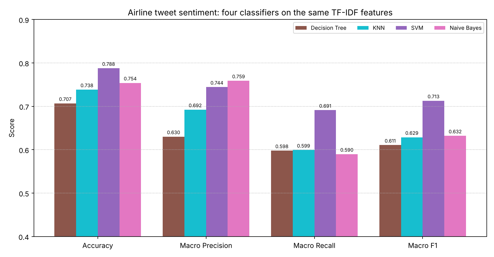
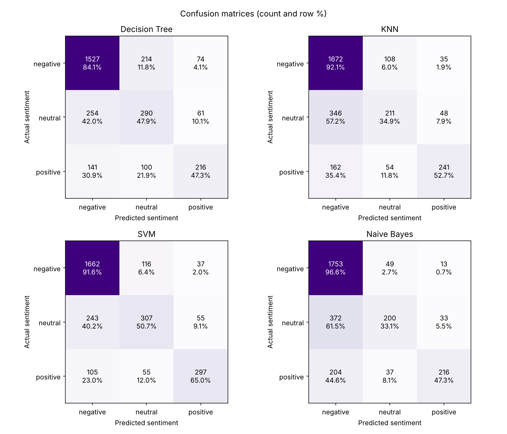
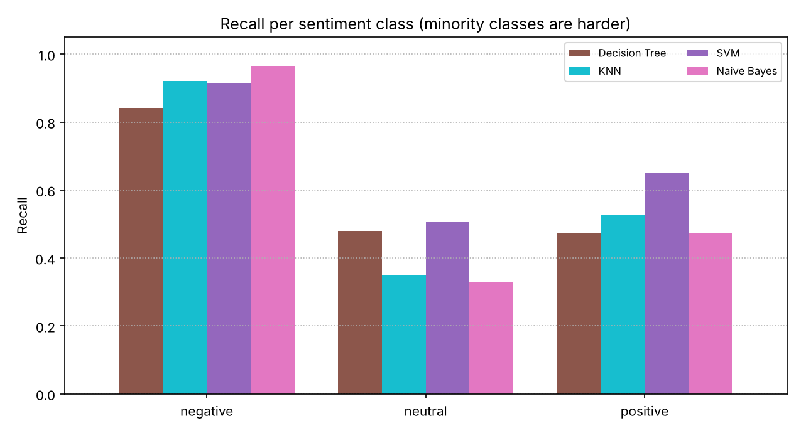
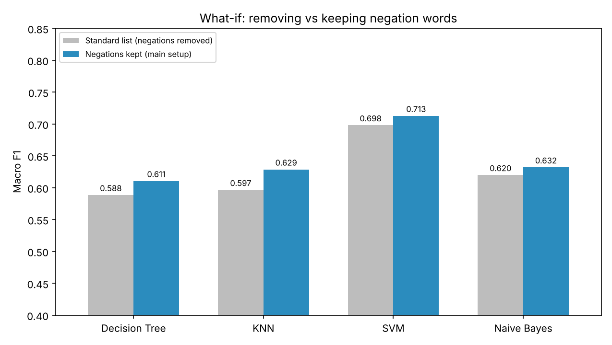

# Sentiment Classification of Airline Tweets — Decision Tree vs KNN vs SVM vs Naïve Bayes

**Information Retrieval (21CSE377T), CLA-2 Task 2**
Vino Bala V (RA2411026050054), III Year CSE AIML A

This project uses the TF-IDF representation from Task 1 for **sentiment analysis**. Each customer tweet is classified as *negative*, *neutral* or *positive*. The four required classifiers are compared under the same setup.

## Dataset

**Twitter US Airline Sentiment** (Figure Eight / Crowdflower "Data for Everyone", February 2015). It contains 14,640 real tweets addressed to six US airlines. Each tweet was labelled by human contributors.

The pipeline removes 213 duplicate tweets and 45 tweets that are empty after preprocessing. That leaves **14,382 tweets**. The counts below are from before the 45 empty tweets were dropped:

| Sentiment | Tweets | Share |
|---|---|---|
| negative | 9,080 | 62.9% |
| neutral | 3,057 | 21.2% |
| positive | 2,290 | 15.9% |

The classes are **imbalanced**. A model that always predicts "negative" already gets 62.9% accuracy, so macro precision, recall and F1 are the main metrics here.

## Method

1. **Cleaning:** remove @mentions, links and HTML entities, and expand "n't" to "not".
2. **Preprocessing** (as in Task 1): lowercase, alphabetic tokens, stop-word removal and Porter stemming. The one difference is that **negation words** (not, no, never, nothing, …) are kept, because they reverse sentiment.
3. **Split:** stratified 80/20 (11,505 training / 2,877 test tweets), with `random_state=11`.
4. **Features:** TF-IDF on unigrams and bigrams, so phrases like "not wait" and "no worri" become features. Settings are `min_df=2` and `sublinear_tf=True`, giving 12,236 features.
5. **Classifiers:**
   - Decision Tree (`min_samples_leaf=2`)
   - KNN (k=20, cosine distance)
   - Linear SVM (C=0.5)
   - Multinomial Naïve Bayes (alpha=0.3)
6. **Evaluation:** accuracy, macro precision, recall and F1, confusion matrices and recall per class.
7. **What-if experiment:** the standard stop-word list, which deletes negation words, is compared with the negation-preserving list.

## Results (2,877 test tweets)

| Model | Accuracy | Precision | Recall | F1 |
|---|---|---|---|---|
| Decision Tree | 0.7066 | 0.6300 | 0.5978 | 0.6105 |
| KNN | 0.7383 | 0.6922 | 0.5991 | 0.6286 |
| **SVM** | **0.7876** | 0.7442 | **0.6910** | **0.7127** |
| Naïve Bayes | 0.7539 | **0.7588** | 0.5897 | 0.6319 |

- Every model recognises negative tweets well, with 84–97% recall. Neutral and positive tweets are much harder.
- Naïve Bayes labels 61.5% of neutral tweets as negative. Its class prior, 63% negative, pulls uncertain tweets towards the majority class.
- SVM gives the best balance across classes, with 65% recall on positive tweets.

**What-if (macro F1):**

| Model | Negations removed | Negations kept |
|---|---|---|
| Decision Tree | 0.5885 | 0.6105 |
| KNN | 0.5965 | 0.6286 |
| SVM | 0.6980 | 0.7127 |
| Naïve Bayes | 0.6198 | 0.6319 |

All four models get worse when "not", "no" and "never" are deleted. Standard stop-word lists are not safe for sentiment tasks.






## Run

```bash
pip install -r requirements.txt
python sentiment_battle.py
```

The tables are saved to `tables/` and the figures to `figures/`.
